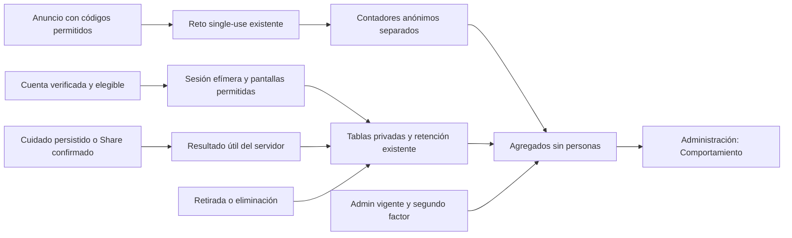

# #150 — candidato preparado para una decisión de publicación

Fecha:28-oct-2026, Guatemala. [Issue y autorización de implementación](https://github.com/DigitalAppcorp/pazo-app/issues/150), incluida su aclaración6479704793. **Nueva colección OFF, migración no instalada y producción conservada.** No se reutiliza el GO147.

## Qué podrás entender en Administración

La sección **Comportamiento** responde dos preguntas, con un resumen legible antes del detalle:

1. **¿Hasta dónde llegan los anuncios?** Distingue interacciones antes del registro, cuentas con correo verificado, primera mascota, apertura de herramientas y utilidad confirmada. Señala qué tramo revisar, sin llamar abandono a una última pantalla.
2. **¿Qué usan al volver?** Muestra herramientas de regreso, primera acción útil, frecuencia observada y regreso en días1/7. Separa volver a abrir de guardar un cuidado o confirmar Share.

Filtros por origen/anuncio con nombres reconocibles, selección visible y controles plegables para llegar antes a los resultados en móvil. Lectura rápida con base de cuentas y recomendaciones expresamente etiquetadas como hipótesis. Campañas y Actividad se conservan; no hay panel externo ni seguimiento individual.

**Ejemplo de laboratorio, no usuarios de PAZO:**20 cuentas verificadas del anuncio →20 primeras mascotas →20 primeras vistas de herramientas →10 utilidades confirmadas. Otra comprobación separa20 regresos de apertura y10 con utilidad en una ventana madura. El regreso después de primera utilidad tiene su propio denominador:10 maduras/10 reaperturas/10 utilidades en ese caso sintético. El sistema no utiliza solicitudes anónimas como denominador de personas.

[Capturas y datos sintéticos comprobables](evidence/issue150/README.md) · [decisión y crítica de Design OS](PAZO_ISSUE150_DESIGN_REVIEW.md).

## Entrega y candidato

| Elemento | Estado |
|---|---|
| [PR151](https://github.com/DigitalAppcorp/pazo-app/pull/151) | Implementación y evidencia; sin merge ni auto-merge |
| Frontend exacto | `2b623bb84a0956f765b4d475fb4697a68d221e3a`; cambios posteriores de SQL preparado/pruebas/documentación no alteran el frontend validado |
| [Staging protegido](https://pazo-7f4g5xiro-digitalapp.vercel.app) | `dpl_5iaJKnb7FtRyhBXWRejWEL2ad3Rz`, READY, preview, mismo GitSHA; seis hashes JS verificados |
| SQL | `20261028210000_pazo_behavior_observation.sql`, PREPARED_NOT_APPLIED, OFF; bytes/SHA256 en [manifest](evidence/issue150/migration.json) y [mapeo aditivo](evidence/marketing-e2e-20261026/prepared-migrations.json) |
| Producción | Sigue `4ce38450` / `dpl_GRzYRttARoYb6QaKX6fEuvWo2p4p`; ambos aliases oficiales sin cambios |
| Supabase |133 versiones y MD5 anteriores intactos; tablas/flag nuevos ausentes; utilidad previa ON desde19:17:46.696036UTC, retención14d saludable |
| Design OS | DESIGN_QA_PASS interno, PO_VISUAL_ACCEPTED=NOT_REQUESTED; revisión profesional separada del permiso de publicación |

El staging verifica assets alojados reales y navegación nativa hasta Administración. Su backend nuevo se conecta **mediante transporte de QA a PostgreSQL17 aislado**, con Auth/dominio controlados: no se instaló el esquema nuevo en Supabase de producción ni se ofrece el informe nuevo como dato real alojado. Las capturas muestran el resultado sin que el PO tenga que ejecutar SQL. No se creó un branch Supabase facturable.

## Qué se mide y qué no

| Medida | Significado y límite |
|---|---|
| Llegada, botón registro, formulario abierto, solicitud/error | Contadores anónimos de interacciones protegidas con Turnstile single-use y allowlist; pueden repetirse por persona. Sin campaña válida o sin protección: no medido |
| Origen | Anuncio aceptado por backend o desconocido. No se inventan orgánico/directo a partir de ausencia de UTM |
| Sesión observada | UUID efímero en memoria, reinicio de página o inactividad; no visitante único ni primera visita histórica |
| Pasos y últimos puntos | Transiciones agregadas; sin secuencias personales. Una acción útil posterior excluye ese punto de la categoría sin continuación. Cierre/background/red siguen siendo desconocidos |
| Utilidad | Cuidado confirmado en transacción o primera compartición QR resuelta por el navegador; abrir QR/descargar no prueba utilidad, guardado ni entrega externa |
| Regreso | Días de Los Angeles con ventanas terminadas. D1/D7 desde primera sesión observada y D7 después de primera utilidad se calculan por separado |
| Cobertura y muestra | Desde activación futura, máximo14d efectivos, sin sesiones retroactivas. Grupos<10 y complementos pequeños se suprimen |

Orgánico probado, directo fiable, usuarios únicos anónimos, historial previo, motivos psicológicos y repetición completa de Share: **no inferibles con estas fuentes**. La pregunta voluntaria de motivos se descartó por fricción innecesaria; no es una dependencia del reporte. No se promete D30/D90, causalidad, ROI ni cifras oficiales de Meta.

## Flujo de datos

## Pruebas y auditoría

- **18 unitarias nuevas PASS:** límites, cola, reintentos, visibilidad, refresh, A→B→A/logout y validación de informes; Edge OFF, rechazo de datos libres y reto obligatorio.
- **64 comprobaciones PostgreSQL17 PASS**, más dos aserciones de atomicidad DDL: ACL/RLS, anon/no admin/aal1, QA, eventos falsificados, concurrencia, recuperación tras lock, presupuestos, retención/Cron, borrado/retirada concurrente, cuidado que persiste bajo bloqueo métrico y resultados matemáticos conocidos.
- **48 casos visuales /144 comprobaciones PASS:** ES/EN320/390/430/1440; contenido, pausa, muestra insuficiente, error/reintento, espera y MFA. Filtros, teclado y dos preguntas.0 pageerrors/0 escrituras QA alojadas.
- **Instrumentación activa únicamente en laboratorio PASS:** tres recorridos del App/hook real al SQL aislado,14 llamadas nuevas controladas; GPC evita nueva colección y retirada real borra sesiones activas. El literal del producto sigue OFF.
- **Staging PASS:** cuatro recorridos ES/EN390/1440, App → primera mascota → Mi mascota → Administración → informe; reintento local aunque fallen otras consultas.0 pageerrors,0 llamadas de colección nueva y0 escrituras alojadas.
- Gobernanza completa, TypeScript/build, nueve guards de historia y lint acotado de módulos nuevos PASS. Los workflows de regresión cubren Auth/MFA, QR/Cuidados, PWA, pagos/invitaciones, Admin y Lugares existentes. [CI del PR151](https://github.com/DigitalAppcorp/pazo-app/pull/151/checks) contiene el head y sus evidencias finales; el comentario de cierre técnico en150 registra los enlaces exactos tras comprobarlos.

Se corrigieron en el proceso: caché de pruebas ausente en runner limpio; expectativa de que todos los writers concurrentes debían superar un timeout opcional; simulación inválida de overview; nombre Mapa/Map en navegación de QA; orden de hitos y semántica de acciones útiles posteriores. No se debilitó el permiso ni se omitió una fila duplicada para pasar un test. Los fallos de harness se separan de fallos del producto.

## Privacidad, límites y operación

Tablas privadas FORCE RLS, RPC ligada a auth.uid, enums cerrados, orden/idempotencia servidor, límites por cuenta/sesión, sin texto/URL/IP/ubicación/contenido/pago. Admin real + JWTaal2; no listado de personas ni exportación cruda. Cola acotada y fallos no bloqueantes; retirada serializada para impedir escrituras obsoletas. QA/admin/founder excluidos por backend. Nueva política ES/EN preparada y preferencia GPC respetada; no Pixel/CAPI/GA4/PostHog.

Los registros vinculables dejan de ser elegibles a14d desde cada sesión. La purga física habitual cada6h puede retrasarse por incidentes; backups/logs tienen ciclos propios. No se promete borrado instantáneo de copias. No se prolonga la fecha de una sesión con visitas y no se guardan agregados históricos en secreto. Fuentes DOJ/CPPA y alcance de revisión en [auditoría y runbook](PAZO_ISSUE150_PRIVACY_AND_RELEASE.md); esto no certifica aplicabilidad/cumplimiento jurídico empresarial.

No se afirma login MFA humano nuevo, dispositivo físico, cobro, entrega externa de Share, impacto de negocio o mejora de rendimiento. Se conservan warnings de chunks y deuda general de lint heredada; el lint de los módulos nuevos pasa. Las advertencias Supabase heredadas no se cambiaron en producción: [security definer autenticado](https://supabase.com/docs/guides/database/database-linter?lint=0029_authenticated_security_definer_function_executable), [tablas privadas sin políticas cliente](https://supabase.com/docs/guides/database/database-linter?lint=0008_rls_enabled_no_policy), [contraseñas filtradas](https://supabase.com/docs/guides/auth/password-security#password-strength-and-leaked-password-protection).

**Única decisión pendiente: GO final de publicación.** El runbook incluye revalidar heads/historia, instalar solo SQL único OFF, publicar aviso/frontend/Edge correctos, activar solo behavior con fecha/versionado reales, postflight y reversión. Ante fallo: apagar behavior y volver al frontend/Edge147 conservando purga y medición anterior. No merge, instalación alojada, activación de datos, anuncios, gasto ni cambios de PayPal/invitaciones se ejecutaron por esta tarea. #150 permanece abierto para ese release;142/147 siguen cerrados.
