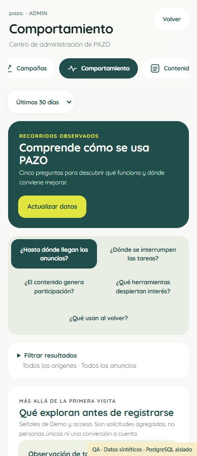
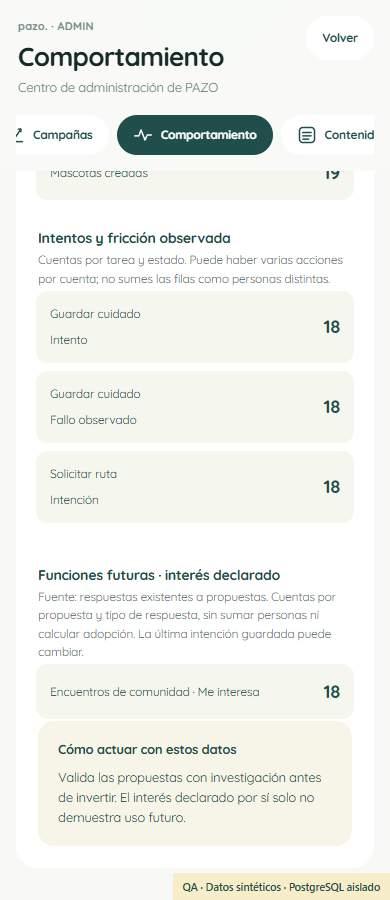
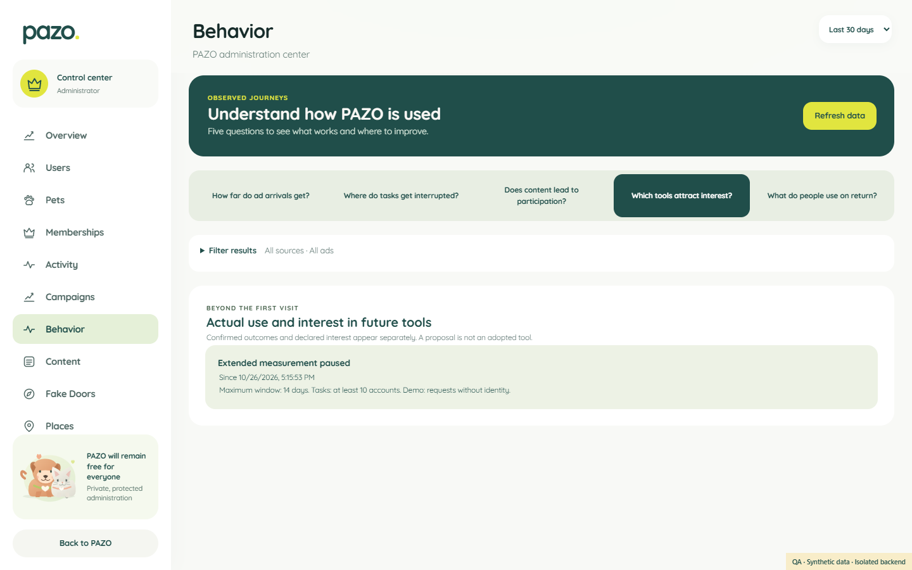

# PAZO #153 — READY_FOR_PO_GO

**Fases 0–6 completas. Candidato probado y preparado para revisión/publicación, sin lanzamiento ni nueva medición activa.** [PR #155](https://github.com/DigitalAppcorp/pazo-app/pull/155). Código funcional verificado: `63c81bd069d5c011b12e1402c23e00d06a647754`; los commits posteriores contienen documentación/evidencia y su verificación se ve en el PR. Sin bloqueos técnicos que requieran intervención del PO.

## Qué queda implementado

Administración → Comportamiento responde cinco preguntas en lenguaje de producto: anuncios y Demo; interrupciones de tareas; participación del feed/comunidades; uso real e interés en propuestas; actividad al regresar. Conserva Campañas, Actividad, MFA y los informes #150.

La ampliación registra 37 tareas semánticas y 19 señales anónimas permitidas; reutiliza sesiones, fuentes de negocio, búsqueda, mapa y respuestas de fake doors de 11 módulos. No captura cada clic, consulta, contenido, ubicación o dato financiero. Distingue intento, fallo, reintento y resultado confirmado; no acepta éxito del navegador como hecho de negocio ni conecta Demo a cuentas.

Se clasificaron 643 definiciones de controles en 118 archivos: 34 instrumentadas por su tarea/emisor, 63 reutilizan fuente y 546 excluyen conscientemente campos, controles locales o ámbitos sensibles. Cero controles sin clasificar; cobertura estática exhaustiva no significa haber pulsado 643 botones en pruebas ni recogerlos todos. [Matriz](EVENT_COVERAGE_MATRIX.md) y [taxonomía](EVENT_TAXONOMY_V1.md).

Gates independientes OFF, límites de colas/lotes/sesiones, vigencia por generación Auth y mascota, GPC/retirada/QA, SQL privado con RLS y permisos, informes MFA agregados y retención de 14 días mediante el Cron existente. Supresión consistente entre orígenes, anuncios y 7/14 días evita reconstruir grupos pequeños por resta. [Privacidad y coste](PRIVACY_SECURITY_AND_COST_REVIEW.md).

No cambia ranking, pesos, reglas comerciales, pagos ni invitaciones. Se verificó la limitación del feed: impresión/vista comparten deduplicación de 24 horas y retirar una reacción borra su relación. El panel lo explica y no inventa tiempo de lectura ni historial de retiros.

## Evidencia de validación

| Comprobación | Resultado |
| --- | --- |
| Unitarias/Edge y límites/privacidad/vigencia | 56 PASS |
| PostgreSQL 17 real, esquemas sintéticos | 69 nuevas + 64 de #150 PASS |
| Gobernanza/regresiones | 776 PASS |
| Historial de migraciones | 15 PASS; migración nueva preparada, no instalada |
| Protección contra base main | 543 archivos de Auth/feed/fake doors/finanzas/admin/PWA/SQL previos intactos |
| Administración nativa ES/EN | 200 comprobaciones, 36 casos, 320/390/1440 px, 0 page errors |
| Tipografía primaria y crítica visual | 3 casos, 18 capturas de las 5 preguntas, incluido 320 px; Quicksand del producto |
| Navegación móvil lenta/offline y QR | 3 anchos PASS; feed pendiente no bloquea herramientas; retry por servicio |
| Build y lint acotado | PASS; no se afirma que toda la deuda legacy de lint esté resuelta |
| Rendimiento controlado | 168 muestras calientes comparables; servicios de 250 ms/telemetría de 5 s; herramientas siguen respondiendo. No es INP de campo ni prueba de mejora |
| CI funcional | 8 workflows SUCCESS, incluido el nuevo de inteligencia; [ejecución propia](https://github.com/DigitalAppcorp/pazo-app/actions/runs/40793961168) y [CI general](https://github.com/DigitalAppcorp/pazo-app/actions/runs/40793961171) |
| Preview final | 4 casos ES/EN 390/1440 PASS: onboarding, 5 preguntas, retry/offline; 0 nuevas llamadas de colección, 0 escrituras alojadas |

[Detalle y límites de pruebas](TEST_MATRIX_AND_EVIDENCE.md). [Manifiesto SHA256 de 22 evidencias](evidence/EVIDENCE_MANIFEST.json), aproximadamente 806 KB de metadatos y capturas sintéticas. No incluye secretos ni datos reales. Los números de prueba no se presentan como uso real o demanda.

## Calidad visual

**DESIGN_QA_PASS interno · PO_VISUAL_ACCEPTED=NOT_REQUESTED · RELEASE_AUTHORIZED=false.** Design Intelligence OS y Marketing Brain OS se aplicaron con investigación, crítica propia separada y correcciones; no se atribuye una revisión independiente inexistente. [Decisiones y correcciones](DASHBOARD_DECISION_SPEC.md).

Preguntas agrupadas, acciones distribuidas, filtros compactos, unidades/cobertura visibles y propuestas separadas de adopción. Se inspeccionaron runtime completo con scroll, contenido, pausa, muestra protegida, carga, error y MFA. Se corrigieron jerarquía, separación de propuestas, identificación por módulo, fidelidad tipográfica y semántica de los estados/fuentes.

## Candidato y condiciones del lanzamiento

[Preview definitivo](https://pazo-7wiavkkjb-digitalapp.vercel.app), deployment `dpl_6NGhd8Rnn142zrv8DYHJyAs1z2kT`, READY y target preview, Git63c81bd0. La verificación usa sus assets reales y la aplicación nativa, con Auth/servicios controlados y RPC reales en PostgreSQL 17 desechable; **no es una base Supabase alojada de staging ni una prueba humana MFA/PayPal**. No se crean cuentas, cobros o conversiones artificiales en producción.

SQL preparado `20261029010000_pazo_product_intelligence.sql`, SHA256 normalizado LF `7e3e12eb0968aa97c8f0d8f92cd32e46b18b5bf111e916758bc54468db87ba2f`. [Manifest preparado](PREPARED_MIGRATIONS.json). Frontend, aviso ES/EN y Edge nuevos OFF; migración sin instalar. Su activación y publicación necesitan únicamente el GO final del PO, seguido del [runbook técnico completo](RELEASE_RUNBOOK.md).

Producción conservada en `dpl_9uXdNs5HAXmLZAaDd7r2z59uQw8K`: 134 migraciones/MD5 sin cambios, gates y fechas #150/utilidad iguales, 4 funciones de algoritmos intactas, mismo Cron y retención saludable, sin tablas nuevas alojadas. [Verificación](evidence/production-preserved.json).

Riesgos residuales: sin evidencia de demanda/retención real suficiente; origen sin atribución sigue desconocido; anónimos son solicitudes y no personas; los borrados cambian recuentos de fuentes persistidas; faltan INP de campo y prueba de escala productiva del informe. El timeout de consulta mantiene recuperación local y los otros informes disponibles. Mapbox/proveedores reales conservan sus integraciones, sin ejecutar rutas, shares o pagos reales para esta entrega. No se certifica cumplimiento legal universal ni se promete borrado instantáneo de backups/logs.

**Sin merge, sin producción y sin activación de nuevos datos. Fase 7 queda pendiente exclusivamente del GO final de lanzamiento.**
